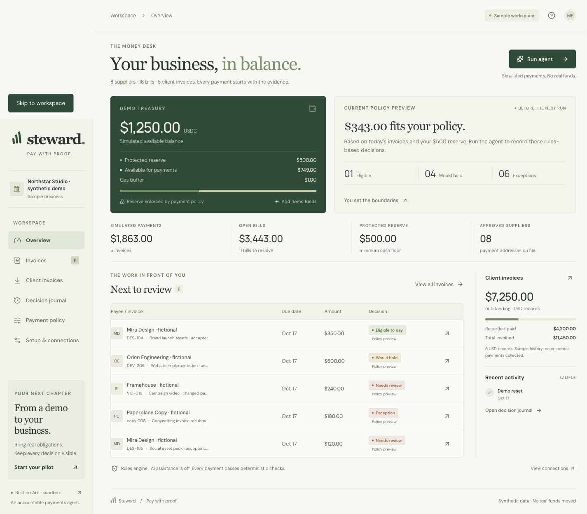

# Steward

Steward is a payables agent for small businesses that pay suppliers in USDC on Arc. It checks every invoice before money moves, keeps an operating cash reserve intact, and records why each payment was made, held or refused.

[Demo video](https://vimeo.com/1236902639) · Built for the [Tameion](https://tameion.thecanteenapp.com/) hackathon



## Why

A transfer that succeeds can still be the wrong payment. Before paying a supplier, a business has to confirm the payout address hasn't changed, match the invoice to an order, check the work was accepted, avoid paying the same bill twice and keep enough cash for rent and payroll. Those checks usually live in email and spreadsheets, and nothing stops a payment when one is skipped. With stablecoins, settlement is instant and final, so the checks have to happen before the transfer.

## How it works

1. **Policy.** The owner sets an operating reserve, a fee buffer, a per-payment cap, a per-run cap and an approval threshold.
2. **Review.** On each run the agent evaluates every open invoice against the approved vendor list, purchase order, delivery acceptance, duplicate detection, due date, caps and the reserve. Each invoice gets one of four decisions, with the reasons attached:
   - `pay` – all checks pass and the payment fits the budget
   - `hold` – valid, but paying now would break the reserve or it isn't due yet
   - `escalate` – needs the owner, for example a changed payee or missing acceptance
   - `block` – duplicate, over the cap or otherwise invalid
3. **Execution.** Payments go through Circle Developer-Controlled Wallets on Arc. The server stores a payment intent with a stable idempotency key before calling Circle, so a retry or a second run can't pay the same invoice twice.
4. **Reconciliation.** An invoice is marked paid only after the Circle transaction is `COMPLETE` and the wallet, network, recipient, amount, token and reference all match the intent.
5. **Release.** Held invoices are reconsidered when funds arrive or the policy changes. The reserve is never relaxed to make a payment fit.
6. **Audit.** Every decision and payment step is written to a hash-chained journal that can be exported and verified.

An optional LLM review can be enabled with any OpenAI-compatible provider. It can hold or escalate a payment the rules approved, but it can't approve one that failed a rule, change a recipient or raise an amount. The response schema has no amount or address fields. It is off by default.

A separate **Client invoices** view tracks money owed to the business: totals, payments received, due dates and acceptance status, with a suggested next step for each record. It never sends reminders or payments.

## On Arc testnet

Steward has completed five transfers (13.85 USDC) on Arc testnet through Circle, all submitted by the app's own API and reconciled against Circle and the chain.

The main run was a batch of ten invoices. The agent paid the three clean ones (9.35 USDC), held one for the reserve and refused six: two copies of the same invoice with the number written differently, a changed payee, missing acceptance, an amount over the cap and a bill not yet due. Running it again paid nothing. After the reserve was lowered, the held invoice was released and paid (3.50 USDC).

Transaction links, balances and the full exports are in [docs/circle-verification.md](docs/circle-verification.md). The invoices in these runs are sample data and both wallets are developer-controlled test wallets.

## Getting started

Requires Node.js 22.13+ and npm.

```sh
npm ci
npm run build
node --import ./scripts/sites-env.mjs ./node_modules/wrangler/bin/wrangler.js d1 execute DB --local --config dist/server/wrangler.json --persist-to .wrangler/state --file drizzle/0000_peaceful_millenium_guard.sql
npm run dev
```

Open the URL the dev server prints. The sample workspace loads with 16 supplier invoices, eight suppliers and five client invoices, and runs without any credentials using simulated payments. Local sign-in uses a mock identity, so keep the dev server on loopback.

## Configuration

Copy `.env.example` to `.env.local`. Both `.env.local` and `.dev.vars` are git-ignored.

| Variable               | Purpose                                                             |
| ---------------------- | ------------------------------------------------------------------- |
| `CIRCLE_API_KEY`       | Circle testnet API key (`TEST_API_KEY:...`); live keys are rejected |
| `CIRCLE_ENTITY_SECRET` | Registered entity secret, 64 hex characters                         |
| `CIRCLE_WALLET_ID`     | Developer-controlled wallet on Arc testnet                          |
| `CIRCLE_BLOCKCHAIN`    | `ARC-TESTNET` (the only accepted value)                             |
| `STEWARD_OWNER_ID`     | User ID allowed to send Circle payments and change policy              |
| `STEWARD_ENABLE_AI`    | `true` to enable LLM review; defaults to `false`                    |
| `STEWARD_AI_PROVIDER`  | `compatible` or `openai`                                            |
| `STEWARD_AI_BASE_URL`  | HTTPS base URL for a compatible provider                            |
| `STEWARD_AI_API_KEY`   | API key for the compatible provider                                 |
| `STEWARD_AI_MODEL`     | Model name for the compatible provider                              |
| `OPENAI_API_KEY`       | OpenAI key, used only when the provider is `openai`                 |
| `OPENAI_MODEL`         | OpenAI model, defaults to `gpt-5.4-mini`                            |

[docs/circle-setup.md](docs/circle-setup.md) covers creating the Circle key and wallet. Once configured, `npm run test:circle` reads the wallet and its USDC balance without sending anything. Provider details and request formats are in [docs/integrations.md](docs/integrations.md).

## Testing

```sh
npm test                   # 79 unit and integration tests, providers mocked
npm run typecheck
npm run build
node tests/api-smoke.mjs   # against a running dev server
```

The API smoke test covers concurrent runs, payment replay, balances, exports and session isolation, and refuses non-loopback URLs. `tests/receivables-api-smoke.mjs` does the same for client invoices. `scripts/verify-circle-scenario.mjs` reproduces the ten-invoice batch against a real Circle testnet wallet using a separate local Worker and database.

## Project layout

```
app/                  UI and API routes (workspace actions, audit export)
lib/engine.ts         invoice rules and pay/hold/escalate/block decisions
lib/runner.ts         runs, payment intents and reconciliation
lib/circle.ts         Circle Developer-Controlled Wallets adapter
lib/planner.ts        optional LLM review
lib/audit.ts          hash-chained decision journal
lib/receivables.ts    client invoice review
lib/store.ts          D1 persistence with workspace locking
tests/                unit, integration and API smoke tests
docs/                 Circle setup, integration contract, testnet evidence
```

Stack: React, Vinext (Next.js App Router on Vite), Cloudflare Workers, D1 with Drizzle, Circle Developer-Controlled Wallets, Arc testnet.

## Limitations

- Testnet only. Mainnet execution is disabled.
- Caps, allowlists and the reserve are enforced by the server, not by an onchain policy. Circle's custom wallet policies are not available on testnet yet.
- Vendor approval and delivery acceptance are entered by the operator, not verified independently.
- The journal's hash chain detects edits to individual entries, but a server operator could replace the whole history.
- No accounting system integration or scheduled runs yet.
